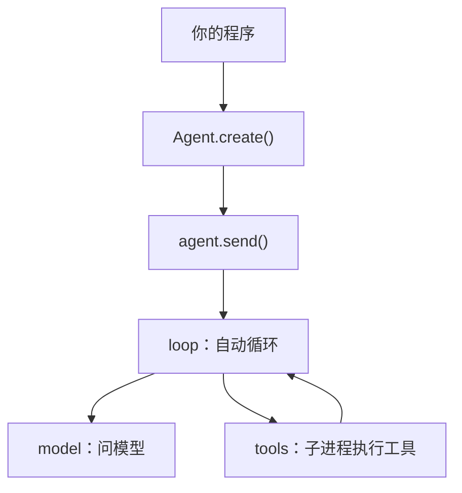

# @kernel4632/agent-core

[](https://github.com/kernel4632/agent-core/actions/workflows/ci.yml)
[](https://github.com/kernel4632/agent-core/releases/latest)

一个轻量的 AI Agent 核心包（TypeScript，运行在 Bun 上）。给它一个模型和一组工具文件路径（也可以接 MCP 服务），
它就自动循环"问模型 → 执行工具 → 再问模型"，直到任务完成。

---

## 目录

- [这个包是干什么的](#这个包是干什么的)
- [核心设计](#核心设计)
- [安装](#安装)
- [5 分钟快速上手](#5-分钟快速上手)
- [工具文件](#工具文件)
- [接 MCP](#接-mcp)
- [API 参考](#api-参考)
- [上下文与压缩](#上下文与压缩)
- [上生产前](#上生产前)
- [项目架构](#项目架构)
- [开发与发布](#开发与发布)
- [这个包不做什么](#这个包不做什么)

---

## 这个包是干什么的



模型每次回复要么"调用某个工具"，要么"我做完了"。这个包负责把循环跑起来；你只需要写工具文件，把路径交给它。

---

## 核心设计

**① Agent 是唯一的状态持有者。** 宿主能改的东西都是实例上的公开字段：`config`、`history`、`tools`、`MCP.list`、
`contextRatio`、`ratios`（以及 `id`）。直接改，下一轮请求就生效，不需要调任何"通知"方法。
内部状态（子进程、工具缓存、MCP 连接、取消器）是私有字段，模块里没有任何全局可变状态，多个实例完全隔离。

**② 工具只认文件路径。** `tools` 是路径数组，目录是"其中全部工具文件"的简写。每一轮请求前现读：
文件改了（修改时间变了）自动重读，路径删了下一轮就没有这个工具。插件、技能、开关这些概念属于宿主——
宿主按插件增删路径即可，核心不知道"插件"是什么。

**③ 每个工具调用独占一个子进程。** 用 `process.execPath`（当前 Bun）启动，经 IPC 通信。工具死循环、崩溃都不会拖垮 Agent；
`agent.stop()` 直接杀掉本实例的全部子进程，不给工具任何反应时间。

**④ history 只增不删，只有 loop 写它。** 模型消息、工具结果按发生顺序追加；压缩也只追加一条 `role: 'compact'` 的总结。
每个出口都补一条模型能读的结果（工具失败、调用无效、被取消都会写一条结果），绝不留下"有调用、没结果"的残缺记录。

**⑤ 停不停由模型和工具决定，没有"最大轮数"。** 模型不调工具时，先临时挂一句提醒再问（不进 history），
连续 `noToolRounds` 轮（默认 3）都不调才结束；工具返回 `stop: true` 立即结束。

---

## 安装

需要 [Bun](https://bun.sh) ≥ 1.4.4（不支持 Node.js）。

```bash
bun add @kernel4632/agent-core
# 或从 GitHub Release 安装最新版
bun add https://github.com/kernel4632/agent-core/releases/latest/download/agent-core.tgz
```

发布包是单文件 `dist/agent-core.js`（依赖全部打进去，工具子进程入口也内联在里面）加 `dist/types/` 类型声明。

---

## 5 分钟快速上手

第一步，写一个工具文件 `tools/say-hello.ts`。它是零依赖的纯对象，不需要 import 任何东西：

```ts
export default {
    name: 'say_hello',
    description: '向指定的人打个招呼',
    parameters: { type: 'object', properties: { who: { type: 'string' } }, required: ['who'] },
    run({ who }: { who: string }) {
        return `你好，${who}！`
    },
}
```

第二步，创建 Agent 并发送指令：

```ts
import { Agent } from '@kernel4632/agent-core'

const agent = Agent.create({
    baseURL: 'https://api.openai.com/v1',
    apiKey: process.env.OPENAI_API_KEY,
    model: 'gpt-4o',
    system: '你是一个助手。',
    tools: ['/abs/path/to/tools'],          // 文件或目录的路径
})

const { reason, text, usage } = await agent.send('请向世界打个招呼', {
    onChunk: chunk => { if (chunk.type === 'text') process.stdout.write(chunk.text) },
})
```

离线可跑的完整示例见 [`examples/minimal`](examples/minimal/)：`bun examples/minimal/main.ts`。

---

## 工具文件

```ts
export default {
    name: string,                    // 工具名（同一个 Agent 内重名的，后读到的被跳过并警告）
    description: string,
    parameters: JSONSchema,          // 只收 JSON Schema，顶层必须是 type: 'object'
    run(args) { ... },               // 只有 args；可以是 async，也可以是 async generator
    toModelOutput?({ output, input, toolCallId }) { ... },  // 可选：把结果改写成给模型看的输出块（与 AI SDK 同签名）
    timeout?: number,                // 可选：单次执行超时（毫秒）
}
```

- **一个文件一个工具。** 目录展开时收 `.ts` / `.js` / `.mjs`（不含 `.d.ts`），按文件名排序。
- **返回值：** 字符串或可 JSON 化的值都行；`{ stop: true, ... }` 让循环结束（reason 为 `tool-stop`）。
  generator 的每次 yield 实时转给 `onToolOutput`，全部片段一起作为结果。默认不截断；设了 `maxToolOutput` 时，
  超长的文字（含 `content` 里的文字块）保留开头 70%、结尾 30%，中间注明省略了多少字符并提示模型缩小范围重新获取。
  返回成形块（`{ type: 'text' | 'json' | 'content' | ... }`）但形状不对时，模型收到一条说明哪里不对的错误结果。
- **出错就是结果：** `run` 抛错、超时、子进程崩溃，都会变成一条错误文字结果交给模型，循环继续。
  超时和崩溃的错误里带上工具已经输出的部分（头尾各保留一段）；被系统 SIGKILL（常见于内存不足）和被 `stop()` 取消分开说明。
- **调用本身无效**（参数解析失败、工具不存在）：不问 `onPermission`、不执行，直接写一条"工具调用无效：原因"结果让模型自己改。
- **坏文件不会拖垮循环：** 读不出来（语法错、导出不合法、加载超过 3 秒）的文件被跳过，通过 `onWarning` 提醒一次；
  按修改时间记住，文件没改之前不会每轮重试。
- 工具的 stdout / stderr 通过 `onToolOutput` 实时转给宿主，不会污染和子进程之间的协议。
- 工具子进程和 Agent 权限相同（文件、网络、环境变量）。危险操作请在宿主的 `onPermission` 里拦。

---

## 接 MCP

```ts
agent.MCP.list = [                       // 也可以 Agent.create({ MCP: [...] })，或者原地 push / splice
    { name: 'github', url: 'https://example.com/mcp', headers: { Authorization: 'Bearer ...' } },
    { name: 'legacy', url: 'https://old.example.com/sse', transport: 'sse' },
]
```

核心负责连接（默认 Streamable HTTP，老服务器用 `sse`），工具名统一加 `${name}_` 前缀。
**连接完全异步，从不阻塞**：请求、`send`、`stop()` 都不会等任何 MCP 连接。连接尽早开始（`Agent.create` 时、`MCP.open` 时、
每轮开头发现 `list` 里有新元素时），在后台连上的那一刻起，下一次构建请求就带上它的工具——一次 `send` 中途连上的，下一轮请求就能用。
还没连上的这一轮就是没有它的工具。连接按配置缓存，配置变了自动重建，从数组里删掉的连接会被关闭。
连不上（含握手超过 15 秒）不影响别的工具，原因先记下，由**下一次请求开始时**通过那次 `send` 的 `onWarning` 报一次
（连接可能在没有 `send` 在跑时失败，那一刻没有回调可用；而失败影响的正是下一次请求，在那时报最对得上），
**也不自动重连**——要重试就切一下这条连接的开关（`MCP.close` / `MCP.open`、`enabled`、或改配置）。

**临时关闭某一条：** 元素上的 `enabled` 每轮现读——`false` 断开连接、下一轮起它的工具消失；改回 `true`（或删掉这个字段）下一轮开头重新开连。
也可以用方法，效果相同：

```ts
await agent.MCP.close('github')   // → { name: 'github', found: true, enabled: false, closed: true }，立即断开
agent.MCP.open('github')          // → { name: 'github', found: true, enabled: true }，立刻在后台重连（不等）
```

`MCP.close` 把 `MCP.list` 里同名元素原地换成 `enabled: false` 的新对象并立即断开连接（`closed` 表示是否真的断开了一条已连上的连接，连接中 / 连接失败的记录只是被移出，
`found: false` 表示没有这个名字、什么也没改）；正在执行的该服务器工具调用会以错误结果结束。

---

## API 参考

### `Agent.create(options)`

配置平铺在顶层，另带 `id`、`history`、`tools`、`MCP`（MCP 连接数组，成为 `agent.MCP.list`）、`contextRatio`、`ratios`。同步返回实例，不做 I/O。

| 字段 | 默认 | 说明 |
|------|------|------|
| `model` | 必填 | 模型名（配 `baseURL` / `apiKey`），或 AI SDK 模型实例 |
| `baseURL` / `apiKey` | — | 服务地址与密钥 |
| `protocol` | `'chat'` | `'chat'` / `'responses'` / `'anthropic'` / `'gemini'` |
| `system` | — | 系统提示词 |
| `stream` | `true` | 是否流式 |
| `cache` | 开启 | 提示词缓存：`true` / `false` / `{ key, retention, body }` |
| `textTools` | `false` | 用文字协议模拟工具调用（给不支持原生工具的模型） |
| `media` | 全部 `false` | `{ image, audio, video, file }` 逐项开关。没开的类型（用户消息和工具结果里的都算）发送时换成一句占位文字，history 原样保留，换成支持的模型后原件照常发出 |
| `reasoning` | `'strip'` | 历史里的思考块发不发回模型：`'strip'` 发送前摘掉（与旧版默认一致），`'send'` 原样发回（供应商要求回传时用）。history 里始终保留 |
| `provider` | — | 原样透传给 AI SDK 的生成参数 |
| `maxTokens` | — | 单次最大输出 token |
| `maxToolOutput` | 不截断 | 单个工具结果最多保留多少字符（保留头 70%、尾 30%） |
| `includeUsage` | `true` | `chat` 协议流式时请求 usage（token 校准靠它）；不认 `stream_options` 的中转站设 `false` |
| `maxContextTokens` | `128000` | 上下文预算；`Infinity` 关闭自动压缩 |
| `compactThreshold` | `0.8` | 估算达到预算的这个比例就压缩 |
| `compact` | — | 压缩请求单独用的配置（比如更便宜的模型） |
| `context` | `{ head: 0, beforeSummary: 10, budget: 0.3 }` | 压缩后的保留规则，见下文 |
| `output` | — | 结构化输出格式（AI SDK `Output`） |
| `noToolRounds` | `3` | 连续几轮不调工具就结束 |
| `noToolPrompt` | 内置 | 不调工具时临时挂上的提醒 |
| `retryMaxTries` / `retryMaxElapsed` | 不限 | 重试次数 / 总时长上限 |
| `retryBaseDelay` / `retryMaxDelay` | `5000` / `600000` | 指数退避基数 / 单次上限（毫秒） |
| `requestTimeout` | 不限 | 单次请求超时（毫秒） |
| `retry` | — | 不重试规则：函数（返回 `false` 不重试），或 `{ shouldRetry, skipCodes, skipText, skipKinds }` |

默认值在读取时才套用，所以整份替换 `agent.config` 不会丢默认值。被取消和上下文溢出（`kind: 'overflow'`）永远不重试；
溢出时 loop 会先压缩再重发，最多 3 次。`provider.toolChoice` 只在这一笔真的带原生工具时发送（文字工具模式、压缩请求不带）。

### `agent.send(input?, callbacks?)`

`input` 是一句话或内容块数组；省略就是"从当前历史继续"。返回 `{ reason, text, steps, usage, output? }`（`steps` 是这次问了模型几轮），
`reason` 为 `'finished'`（模型正常收尾 / 没有工具）、`'no-tool'`（连续不调工具）或 `'tool-stop'`（工具要求停止）。

同一实例一次只跑一件事：新的 `send` / `compact` 会先停掉上一次并等它收尾。模型错误会抛出，带 `error.kind`
（`aborted` / `auth` / `limit` / `timeout` / `server` / `network` / `request` / `overflow` / `unknown`）。

回调按次传入，全部可选，抛错或返回被拒绝的 Promise 都不影响循环；`onToolCall` 和 `onStep` 会被等待（返回 Promise 时等它完成再继续）：

| 回调 | 时机 |
|------|------|
| `onChunk(chunk)` | 流式片段：`text` / `reasoning` / `tool-call` / `tool-result` / `finish`；压缩期间见下方 |
| `onPermission(call)` | 工具执行前；严格返回 `true` 才放行，其余（含非布尔值，会警告一次）都拒绝，模型收到"被拒绝"结果。`call.path` 是来源文件；无效调用不会来问 |
| `onInject({ tokens, budget, compactThreshold, ratio, ratioSource })` | 每次请求前；返回的文字临时挂在这次请求上，不进 history。`ratioSource`：`'usage'` 学到的 / `'host'` 宿主给的 / `'default'` 默认值 |
| `onToolCall(call)` / `onToolResult(result)` | 工具开始 / 结束；`path` 用来映射回宿主的插件 |
| `onToolOutput({ toolCallId, stream, data })` | 工具子进程的 stdout / stderr |
| `onStep({ step, reply, results })` | 每轮结束（适合落盘 history） |
| `onCompact({ reason, summary, before, after, budget, compactThreshold, ratio, ratioSource, chars, media, usage })` | 压缩完成；`reason` 为 `'auto'`（估算到阈值）/ `'overflow'`（模型报超长）/ `'manual'`；其余是压缩前的估算诊断 |
| `onRetry({ attempt, maxTries, error, delay })` | 模型请求重试前 |
| `onWarning({ path?, message })` | 坏工具文件、工具重名、MCP 连不上、history 里有发不出去的消息（system / 未知 role / 没有 content）等 |

文字工具模式（`textTools`）下流式照常：调用块之外的正文边收边推，只有可能是调用块的那一段先扣住，确认不是调用再推出。

**压缩也是流式的。** 压缩开始时先来一条 `{ type: 'compact-start', reason: 'auto' | 'overflow' | 'manual', compact: true }`，
之后压缩模型的 `reasoning` / `text` / `finish` 片段都带 `compact: true`，宿主可以实时展示"正在压缩：模型在想什么、总结正文是什么"，
又不会和正式回答混在一起。压缩结束后 `onCompact` 照常给出完整信息（含总结正文）。
压缩请求的流式跟随 `compact.stream ?? stream`（默认流式）；设为非流式时只有 `compact-start`。

### `agent.stop()`

立即停止：中断模型请求，杀掉本实例的工具子进程，给没结果的调用补上"已取消"。返回
`Promise<{ stopped: true, wasRunning: boolean, killed: number }>`，**只在子进程全部确认退出、循环已经退出之后才兑现**——
拿到返回值就说明已经停干净了。`wasRunning` 表示调用时是否有运行，`killed` 是被杀掉的子进程数。正在跑的 `send` 会以 `kind: 'aborted'` 拒绝。

### `agent.compact(callbacks?)`

强制压缩一次，返回总结文字（片段同样通过 `onChunk` 流式推送）。

### `agent.MCP.close(name)` / `agent.MCP.open(name)`

临时关闭 / 重新打开一条 MCP 连接，见[接 MCP](#接-mcp)。

### `Agent.LLM.ask(request, onChunk?)`

不建实例直接问模型：传完整的 `{ model, baseURL, apiKey, protocol, system, messages, tools, textTools, reasoning, stream, includeUsage, cache, provider, maxTokens, output, retry, signal, onRetry }`，
返回 `{ text, toolCalls, usage, output?, messages }`，流式与非流式形状一致。`tools` 只要 `{ description, parameters }`，不会执行。

### 公开字段

| 字段 | 说明 |
|------|------|
| `history` | 消息数组（AI SDK 标准消息 + `id`，外加 `compact` 总结和宿主写的 `error` 记录）。宿主可直接读写；`error` 永远不发给模型 |
| `tools` / `MCP.list` | 工具路径 / MCP 连接配置，增删或整份替换下一轮生效 |
| `config` | 活配置，下一轮生效 |
| `contextRatio` | 冷启动的"每字符 token"估算比例；学到真实值之前用它 |
| `ratios` | 按模型名学到的比例 `{ 模型名: 比例 }`，宿主可持久化后下次传回 |

---

## 上下文与压缩

history 里原文一条不少；每次请求只从里面**现挑**发给模型的内容：

1. 开场的 `head` 个用户回合；
2. 最新一条总结——**折进 system**，不当成消息（当消息发，模型会以为用户塞给它一张表，从头重做）；
3. 总结之前最近的 `beforeSummary` 个用户回合；
4. 总结之后的全部原文。

`budget × maxContextTokens` 约束第 1、3 段，超出先丢最早的一轮。**进行中的那一轮不会整轮丢掉**：
一次 send 里压缩后它落在总结之前，整轮放不下（或 `beforeSummary` 为 0）时，用户那句话始终保留，
再按"步"（一次模型回复连同它的工具结果）从后往前补回预算装得下的最近几步——模型既看得到"正在做的事"，
也看得到刚刚那一步的现场（刚读到的内容、刚报的错），不用从头再来；`budget: 0` 时只留那句话。
裁剪按回合 / 步进行，工具结果按 `toolCallId` 跟在它的调用后面，落单的调用 / 结果丢掉；
history 里发不出去的消息（`system`、未知 role、没有 content）跳过并 `onWarning` 一次，保证发出去的永远是合法上下文。估算超过 `compactThreshold` 就自动压缩一次（每轮最多一次）；
二次压缩会把上一版总结并进提示词，越压不会越忘。token 估算比例在每次拿到真实 usage 后按模型名校准。

---

## 上生产前

| 旋钮 | 为什么要设 |
|------|------------|
| `requestTimeout` | 默认不限单笔时长，卡住的请求会一直等 |
| `retryMaxElapsed` / `retry` | 默认重试所有可重试错误且无总上限；建议收口，或跳过 `auth`、`request` |
| `maxContextTokens` | 按你模型的窗口调 |
| `maxToolOutput` | 按模型窗口和工具特性设置（默认不截断） |

这个包不限制循环轮数。要兜住"一直调工具停不下来"，由宿主用计时器调 `agent.stop()`，或提供一个返回 `stop: true` 的收尾工具。

---

## 项目架构

```
index.ts                包入口：导出 Agent 和类型
src/
  agent.ts              唯一的状态持有者：create / send / stop / compact、Agent.LLM
  loop/run.ts           一次 send 的完整循环；history 唯一的写入者；compact
  loop/decide.ts        每轮结束后的继续 / 提醒 / 结束判定
  context/build.ts      从 history 现挑这一次要发的上下文
  context/summarize.ts  压缩请求与总结消息
  model/ask.ts          问一次模型（流式 / 非流式 / 文字工具），重试
  model/configure.ts    按协议建 provider、提示词缓存
  model/text-tools/     文字协议工具：describe 描述、parse 解析
  tools/load.ts         展开路径、子进程读元数据、mtime 缓存
  tools/run.ts          并行执行一轮的工具调用
  tools/spawn.ts        启动工具子进程（process.execPath + IPC）
  tools/child.ts        子进程入口
  tools/shape.ts        结果整形与截断
  tools/mcp.ts          MCP 连接
  history.ts            追加、按回合切分、未答复的调用
  utils/                errors（错误分类）、retry（重试）、tokens（估算与校准）
  types.ts              全部共享类型
```

导入只能往下指：`agent > loop > {context, model, tools} > history > utils > types`，同层能力模块互不导入，
`bun run check` 会检查（`scripts/check-imports.ts`）。

---

## 开发与发布

```bash
bun test          # 全部测试（用 ai/test 的 mock 模型，不联网）
bun run check     # tsc 类型检查 + 导入方向检查
bun run build     # 打包 dist/agent-core.js + dist/types，并在临时目录自检
```

开发时工具子进程直接从 `src/tools/child.ts` 启动；打包时 `scripts/build.ts` 把子进程入口打成文本内联进产物，
产物里以 `bun -` 从 stdin 启动，不依赖任何包内文件路径。版本与发布流程见 [AGENTS.md](AGENTS.md)。

---

## 这个包不做什么

- **不保存对话。** `history` 就是内存里的数组，存库、按用户隔离由宿主做（`onStep` 是落盘的好时机）。
- **不管插件和技能。** 插件 → 路径的映射、开关、渲染都在宿主；核心只看路径，结果里带 `path` 方便宿主分发。
- **不算钱。** `usage` 是原始 token 数。
- **不做用户、权限和沙箱。** 只有 `onPermission` 一个挂钩点。
- **不管并发排队和限流。** 一个实例就是一段对话；要多段对话就建多个实例。
- **不支持 Node.js。** 子进程、IPC、打包都依赖 Bun。
